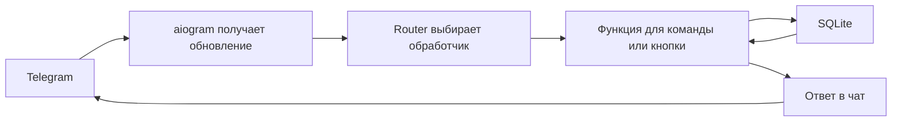

# Как устроен бот «Колледж Помощник»

Разбор исходников версии `1c9a5fc`. Его можно читать вместе с репозиторием. В начале показаны три обычных сценария, дальше у каждого Python-файла есть свой раздел с функциями и переменными. Имена в обратных кавычках совпадают с именами в коде, поэтому их можно искать через Ctrl+F.

[Сценарии в Telegram](#scenarios) · [Синтаксис Python](#python) · [Настройки и запуск](#setup) · [SQLite](#database) · [Расписание](#schedule) · [Рассылки](#broadcasts) · [Справочник и вопросы](#directory) · [Тесты](#tests)

## Что открывать первым

1. [`college_bot/__main__.py`](college_bot/__main__.py) запускает приложение.
2. [`college_bot/bot.py`](college_bot/bot.py) соединяет обработчики и отвечает за выбор группы.
3. [`college_bot/timetable.py`](college_bot/timetable.py) принимает дату или файл расписания.
4. [`college_bot/schedule.py`](college_bot/schedule.py) превращает данные файла в пары с конкретными датами.
5. [`college_bot/database.py`](college_bot/database.py) сохраняет данные в SQLite и читает их по запросу.

Затем можно перейти к рассылкам, контактам, вопросам и тестам. [`README.md`](README.md) держи рядом как инструкцию по запуску и перечень команд.

## Как проходит сообщение

При запуске aiogram запрашивает обновления у Telegram и ждёт следующее сообщение. Это режим **long polling**. Когда обновление приходит, `Dispatcher` передаёт его роутерам. У каждого роутера есть фильтры. Например, фильтр команды `/start` пропускает только эту команду, а `F.text == "Контакты"` пропускает сообщение с таким текстом. Подходящая функция получает объект сообщения и выполняет действие.

### Сценарий 1. Студент выбирает группу

1. `start` получает Telegram ID и имя, вызывает `db.register` и ищет сохранённую группу через `db.user_group`.
2. Если группы ещё нет, `show_groups` запрашивает список групп из базы, выставляет состояние `GroupSelection.name` и присылает кнопки.
3. Студент вводит, например, `  св-21  `. `select_group_by_name` ищет группу по ключу `св-21`. Клик по кнопке идёт в `select_group` и ищет её по числовому ID.
4. Оба обработчика вызывают `save_group`. Выбор сохраняется в `users.group_id`, временное состояние очищается, бот показывает меню. После перезапуска выбор по-прежнему читается из SQLite.

### Сценарий 2. Студент вводит `12.11`

1. `show_schedule` узнаёт группу и текущий год по часовому поясу колледжа. Например, в 2026 году дата превращается в `date(2026, 11, 12)`. Для `12.11.2027` берётся 2027 год.
2. `db.timetable` получает ID группы и диапазон дат. Для одного дня начало и конец совпадают. SQLite возвращает пары и сведения о загруженных днях.
3. `format_timetable` собирает текст. Загруженный день с пустым списком пар даёт «В этот день занятий нет». День, которого вообще нет в базе для этой группы, даёт «На этот день расписание ещё не загружено».

### Сценарий 3. Администратор загружает файл

1. `upload_schedule` проверяет права и скачивает документ как байты.
2. `read_schedule` выбирает формат и строит объект `Schedule`. В него входят группы, охваченные даты и отдельные пары. Например, вариант пары по понедельникам на 2-й и 3-й неделях превращается в две пары на разных датах.
3. Только после успешного чтения `db.replace_schedule` заменяет записи указанной группы на указанных датах. Пустая дата в файле может убрать старые пары на этот день. Даты и группы вне охвата загрузки сохраняются.
4. Бот сообщает число групп и датированных пар. Предупреждения относятся к отдельным неоднозначным записям и могут сопровождать успешный импорт. Ошибка структуры файла отменяет запись в базу.

## Как читать синтаксис в этом проекте

| Запись | Что значит |
| --- | --- |
| `def group_key(name: str) -> str` | Функция принимает строку под именем `name` и возвращает строку. Типы после `:` и `->` помогают читать код. Сами по себе они не проверяют ввод во время работы Python. |
| `self` и `self.db` | `self` обозначает конкретный объект. `self.db` хранит ссылку на базу в этом объекте и доступен из других его методов. |
| `@dataclass` | Python создаёт конструктор и другие обычные методы по объявленным полям. `frozen=True` запрещает переприсваивать поля экземпляра. `default_factory=list` создаёт каждому экземпляру свой список. |
| `str \| None` | Значение может быть строкой или `None`. Например, `group_id=None` в объявлении означает рассылку всему колледжу. |
| `return` и `raise` | `return` завершает функцию и отдаёт результат. `raise` прерывает обычный ход и передаёт ошибку ближайшему подходящему `except`. |
| `async def`, `await` | `async def` описывает корутину. На `await` она может ждать, например, ответа Telegram, пока цикл событий обслуживает другие корутины. |
| `asyncio.to_thread` | Запускает обычную блокирующую функцию в другом потоке. Так разбор Excel или создание копии базы меньше задерживают ответы бота. |
| `with`, `try … finally` | Управляют временем жизни ресурса и обязательной очисткой. Например, `with BytesIO()` закроет буфер, а `finally` закрывает книгу Excel даже при ошибке чтения. |
| `for x in rows`, `enumerate(rows, start=1)` | Перебирают значения. `enumerate` добавляет номер, чтобы ошибка могла назвать строку Excel или номер записи JSON. |
| `[x for x in rows]`, `{x for x in rows}` | Быстро строят список и множество. Список сохраняет порядок и повторы. Множество оставляет уникальные значения. |
| `yield` | Отдаёт очередное значение и приостанавливает функцию. `chunks` так отдаёт части длинного сообщения по одной. |
| `dict[key]`, `dict.get(key, запасное)` | Первая запись требует наличия ключа. Вторая возвращает запасное значение, если ключа нет. |
| `*rows`, `*extra`, `*, headers=None` | Звёздочка может собрать аргументы, распаковать последовательность или сделать последующие параметры именованными. Например, `headers=` при вызове `read_table` явно указывает строку заголовка. |
| `f"Выбрана группа {name}"` | Подставляет значение переменной в текст. SQL использует другой механизм: значения передаются отдельно в параметры `?`. |
| `:=` | Сохраняет значение прямо внутри выражения. В цикле доставки так можно одновременно получить `user_id` и проверить, остались ли адресаты. |
| `a or b`, `a and b` | Python вычисляет вторую часть только при необходимости. `lesson["room"] or "кабинет не указан"` выбирает запасной текст при пустой строке. |
| `r"..."`, `re.compile(...)` | Сырая строка сохраняет обратные косые черты для регулярного выражения. Регулярное выражение ищет текст по форме, например `ДД.ММ` или `нед. 5–7`. |
| `@router.message(...)`, `@router.callback_query(...)` | Декораторы регистрируют функцию в роутере. Условия в скобках определяют, какие обновления она получит. |

### Имена, которые повторяются

- `message` — входящее сообщение Telegram. `message.text` содержит текст, `message.document` описывает файл, `message.from_user` содержит сведения об отправителе. `message.answer(...)` отправляет ответ в этот чат.
- `query` в обработчике кнопки — `CallbackQuery`, событие нажатия inline-кнопки. `query.answer()` завершает ожидание на кнопке или показывает уведомление. `query.message.answer()` посылает отдельное сообщение. В `database.py` имя `query` обозначает строку SQL.
- `callback_data` — разобранные данные кнопки. Например, строка `group:select:12` превращается в `GroupChoice(action="select", value=12)`. Не следует считать номер внутри кнопки подтверждением прав пользователя.
- `state` — `FSMContext`, временная память диалога. `set_state` меняет шаг, `update_data` дописывает данные, `get_data` читает их, `clear` удаляет шаг и данные. В этом проекте состояние по умолчанию хранится в памяти процесса. SQLite хранит результаты, например выбранную группу или опубликованную рассылку.
- `bot` — клиент Telegram API. `router` группирует обработчики, `dp` обозначает главный `Dispatcher`. `F` строит фильтры по полям события. `~F...` отрицает фильтр, `|` объединяет условия по правилу «или».
- `db` — объект `Database`. `conn` — открытое соединение с SQLite, `row` — одна строка результата, `rows` — набор строк. В модуле импорта `row` и `rows` могут обозначать строки файла.
- `settings` — объект настроек приложения. `logger` пишет записи от имени текущего модуля, которое берётся из `__name__`.
- `user_id` — Telegram ID. `group_id` в SQLite — внутренний номер группы. `group_key` формирует текстовый ключ для поиска. Это разные идентификаторы: Telegram ID пользователя никак не связан с ID группы.
- `datetime` объединяет дату и время, `date` хранит календарную дату, `time` — время суток, `timedelta` — длительность. `ZoneInfo` применяет часовой пояс, `timezone.utc` обозначает UTC.

## Настройки, запуск и служебные файлы

| Файл или папка | Назначение |
| --- | --- |
| `college_bot/__init__.py` | Пустой файл, обозначающий Python-пакет `college_bot`. При импорте прикладная логика здесь не запускается. |
| `requirements.txt` | Версии зависимостей. `aiogram` обрабатывает Telegram, `openpyxl` читает Excel, `python-dotenv` загружает переменные из `.env`, `tzdata` поставляет данные часовых поясов, в том числе для Windows. |
| `.env.example` | Шаблон конфигурации, который можно скопировать в `.env`. |
| `.gitignore` | Убирает из обычного добавления в Git файлы `.env`, локальные зависимости, кэш Python и `data/`. Правило с `!` возвращает в исключение шаблон `.env.example`. |
| `.dockerignore` | По умолчанию исключает содержимое из контекста сборки. Разрешает `requirements.txt` и исходники `college_bot/`, затем исключает кэш Python. |
| `Dockerfile` | Описывает сборку образа. |
| `compose.yaml` | Описывает запуск контейнера, его настройки и постоянный том. |
| `data/` | Папка используемых ботом локальных данных. Пути могут отличаться, если изменить `DATA_DIR`. |
| `tests/test_bot.py` | Проверки с временной SQLite и имитацией Telegram. |
| `LICENSE` | Условия лицензии MIT для этого репозитория. |

### Переменные окружения

| Переменная | Значение |
| --- | --- |
| `BOT_TOKEN` | Ключ доступа к Telegram Bot API от BotFather. Его читает `load_settings`. |
| `ADMIN_ID` | Положительный числовой Telegram ID администратора. |
| `TEACHER_GROUPS` | JSON вида `{"123456789":["СВ-21"]}`. Ключ — Telegram ID преподавателя. Значение — список групп, которым он может писать объявления и от которых может получать вопросы. По умолчанию `{}`. |
| `COLLEGE_TIMEZONE` | Часовой пояс для дат расписания и отображения объявлений. По умолчанию `Asia/Almaty`. |
| `DATA_DIR` | Куда писать SQLite, журнал и копии. При обычном запуске значение по умолчанию `data`, в Docker используется `/var/lib/college-bot`. |
| `PYTHONUNBUFFERED` | В Docker стоит `1`, чтобы Python отдавал вывод сразу. |
| `PYTHONDONTWRITEBYTECODE` | В Docker стоит `1`, чтобы Python не создавал `.pyc` при импорте. |

В `Dockerfile` инструкция `FROM` выбирает Python 3.12 на Debian slim. `ENV` задаёт значения окружения. `WORKDIR /app` выбирает рабочую папку. Сначала `COPY` добавляет список зависимостей, чтобы Docker мог переиспользовать слой с `pip install`, когда меняются только исходники. `RUN` устанавливает пакеты, добавляет пользователя `bot` с UID 10001 и готовит папку данных. Второй `COPY` переносит Python-пакет. `USER bot` запускает приложение от этого пользователя. `CMD` выполняет `python -m college_bot`.

В `compose.yaml` ключ `services` содержит сервис `bot`. `build: .` указывает на текущий каталог сборки. `env_file: .env` передаёт настройки контейнеру. `environment` задаёт контейнерный `DATA_DIR`. `volumes` соединяет том `college-data` с этой папкой, так что данные переживают замену контейнера. `init: true` добавляет небольшой процесс для обработки завершения, `restart: unless-stopped` позволяет Docker поднимать бот после сбоя или перезапуска Docker, пока сервис явно не остановлен.

## `college_bot/__main__.py`

Это точка входа для `python -m college_bot`. Проверка `if __name__ == "__main__"` запускает приложение только при выполнении модуля как программы. `asyncio.run(main())` создаёт цикл событий и выполняет корутину `main`.

- `LogFormatter.__init__(self, token)` задаёт формат журнала и сохраняет ключ в `self.token`. В шаблоне журнала `asctime` обозначает время, `levelname` — уровень, `name` — имя логгера, `message` — текст записи.
- `LogFormatter.format(self, record)` получает запись `record`, пользуется обычным форматированием и заменяет точное значение токена на `[скрыто]`. `super()` обращается к родительскому классу `logging.Formatter`.
- `main()` читает `settings`, создаёт каталог и настраивает `handlers`, список направлений вывода. Один пишет в консоль, второй через `RotatingFileHandler` пишет в `bot.log` с ротацией после 1 000 000 байт и хранением до трёх старых файлов. `formatter` форматирует записи, `handler` — очередное направление из списка.

Далее `main` открывает `db` по пути `college.sqlite3` и вызывает `initialize`. В блоке `async with Bot(settings.token) as bot` создаётся Telegram-клиент. `broadcasts` обслуживает очередь отправок. `workers` содержит две фоновые задачи, рассылку и резервное копирование. Пока они работают, `start_polling` принимает сообщения. Параметр `close_bot_session=False` оставляет закрытие сессии внешнему блоку `async with`. В `finally` оба `worker` получают команду отмены. Затем `main` дожидается их остановки, пропуская ожидаемый `CancelledError` через `suppress`.

## `college_bot/config.py`

- `group_key(name)` превращает название `name` в ключ. `split()` разбивает текст по пробельным символам, `join` собирает слова с одиночным пробелом, `casefold()` приводит текст к виду для сравнения без учёта регистра. `"  СВ-21  "` становится `"св-21"`. Дефисы и сами буквы сохраняются.
- `Settings` имеет поля `token` (токен), `admin_id` (администратор), `teacher_groups` (словарь Telegram ID и множеств ключей групп), `timezone` (часовой пояс), `data_dir` (путь к файлам). `frozenset` хранит набор ключей без возможности изменить сам набор.
- `Settings.role(self, user_id)` проверяет Telegram ID. Сначала ищет совпадение с администратором, затем с ключом словаря преподавателей. Возвращает `admin`, `teacher` или `student`.
- `Settings.can_send(self, user_id, group)` проверяет право написать объявление. Администратор может выбрать любую группу или всех. Для преподавателя ключ указанной группы должен быть в его наборе. `group=None` означает получателей по всему колледжу.
- `Settings.question_recipients(self, group)` строит список адресатов вопроса. `key` — ключ группы, `teachers` — подходящие ID. В переборе `user_id` обозначает преподавателя, `groups` — его набор групп. ID администратора добавляется в конец, `dict.fromkeys` удаляет повторы с сохранением порядка.
- `load_settings()` вызывает `load_dotenv` и читает строки через `os.getenv`. `token` должен быть непустым, `admin_id` — положительным целым. `raw` — разобранное содержимое `TEACHER_GROUPS`, `raw_id` — строковый ключ JSON, `teacher_id` — числовой ID после `int`. `groups` — список названий одного преподавателя, `group` — очередной элемент, `teacher_groups` — собранный словарь для `Settings`. Ошибки обязательных настроек останавливают запуск с пояснением.

## `college_bot/bot.py`

`GroupSelection.name` — шаг, на котором текст пользователя можно трактовать как название группы. `GroupSelection` наследует `StatesGroup`, чтобы aiogram мог фильтровать входящие события по этому шагу.

| Функция | Что делает и какие значения использует |
| --- | --- |
| `create_dispatcher(settings, db, broadcasts)` | Создаёт `dp` и основной `router`, ограничивает сообщения и клики личными чатами, подключает роутеры группы, расписания, рассылок, справочника, вопросов и обработчики по умолчанию. `SimpleEventIsolation` последовательно обрабатывает события одной области состояния, чтобы два быстрых ввода не меняли диалог одновременно. Вложенные функции используют переданные `settings`, `db` и `broadcasts`. |
| `start(message, state)` | Обрабатывает `/start`. Очищает временный шаг. `user` — отправитель из `message.from_user`. `group` — строка сохранённой группы или `None`. При наличии группы показывает её и меню, иначе открывает выбор. |
| `show_groups(message, state, prompt)` | `prompt` — текст запроса, который передал вызывающий обработчик. `groups` — строки SQLite с ID и названиями. При наличии групп выставляет `GroupSelection.name` и показывает страницы. При пустом списке направляет к администратору. |
| `save_group(user, group_id, state)` | Регистрирует отправителя `user`, записывает `group_id` и очищает шаг выбора. Эту функцию используют и кнопка, и ручной ввод. |
| `change_group(message, state)` | Получает кнопку «Сменить группу», завершает предыдущий шаг и открывает список. |
| `group_page(query, callback_data)` | Берёт номер страницы из `callback_data.value` действия `select_page`; перерисовывает кнопки под прежним сообщением через `edit_reply_markup`. |
| `select_group(query, callback_data, state)` | Берёт ID группы из действия `select`. `group` — результат поиска в SQLite. Если записи нет, показывает уведомление. Если есть, сохраняет выбор, заменяет текст старого сообщения и присылает меню. |
| `cancel(message, state)` | Реагирует на `/cancel`, «Назад» и «Отмена». Очищает состояние и возвращает меню. |
| `select_group_by_name(message, state)` | Работает на шаге `GroupSelection.name` для текста, который не начинается с `/`. `group` — точное совпадение по нормализованному названию. При опечатке шаг остаётся активным. |
| `fallback_router()` | Создаёт последний `router` для событий, которым не подошёл другой обработчик, и для исключений. |
| `unknown_message(message, state)` | Очищает шаг диалога и показывает меню. |
| `unknown_button(query)` | Отвечает на неизвестное нажатие и убирает индикатор ожидания. |
| `handle_error(event)` | `event` содержит ошибку и исходное обновление. Записывает исключение в `logger`. `query` и `message` — возможное нажатие и сообщение из этого обновления. Для кнопки посылает короткое уведомление, для сообщения в личном чате — подсказку. Если отправка подсказки тоже падает, пишет предупреждение в журнал. |

## `college_bot/ui.py`

В этом файле собраны подписи и способы строить клавиатуру. `PAGE_SIZE=12` означает двенадцать групп на странице. `TEXT_LIMIT=3000` ограничивает тексты, которые пользователь вводит в диалоги. `CHANGE_GROUP`, `BACK`, `CANCEL`, `SCHEDULE`, `ANNOUNCEMENTS`, `CONTACTS`, `FAQ`, `ASK` — подписи кнопок меню, отмены и навигации. `TODAY`, `TOMORROW`, `WEEK` — «Сегодня», «Завтра», «Неделя». Те же значения используются в фильтрах.

- `GroupChoice` описывает данные inline-кнопки с префиксом `group`. Поле `action` различает выбор, перелистывание и рассылку. `value` обозначает ID группы, номер страницы или `0` для рассылки всем. При `pack()` поля кодируются в строку, которую возвращает Telegram.
- `menu()` вызывает `keyboard` с тремя рядами главного меню. Reply-кнопка отправляет в чат свой текст. Inline-кнопка привязана к сообщению и отправляет событие нажатия со скрытыми данными.
- `keyboard(*rows)` принимает несколько кортежей. `rows` — все переданные линии, `row` — одна линия, `text` — надпись кнопки. Из них строится `ReplyKeyboardMarkup` с автоматической высотой.
- `group_picker(groups, action, page=0, everyone=False)` делает inline-список. `last_page` — последний допустимый номер страницы, `page` ограничивается этим диапазоном и начинается с нуля. `builder` собирает кнопки, `group` — запись текущей группы из среза. `everyone` включает «Все пользователи» с `value=0`. `pages` — кнопки перехода, `label` — стрелка, `target` — её страница. Действия листания получают суффикс `_page`.
- `chunks(text, limit=3800)` выдаёт части текста, пригодные для отправки в Telegram. `end` — максимально допустимая позиция разреза в символах Python. `split` — место разреза, по возможности на последнем переносе строки хотя бы во второй половине части. `text` после каждой итерации становится оставшимся текстом. `yield` позволяет обработчику отправлять части по очереди.
- `text_length(text)` измеряет длину в 16-битных единицах UTF-16. Кодирование `utf-16-le` даёт по два байта на единицу, поэтому результат делится на два. Например, многие эмодзи занимают две такие единицы.

## `college_bot/database.py`

`Database` знает путь к SQLite и предоставляет методы для операций приложения. SQL-запросы передают параметры отдельно от текста запроса. Например, `WHERE id = ?` получает значение через кортеж `(group_id,)`. Запятая обязательна для кортежа из одного элемента.

Транзакция объединяет связанные изменения. При импорте это удаление старых пар и запись новых. Если вставка выдаст ошибку, откат вернёт прежнее расписание. WAL означает журнал предварительной записи. SQLite сначала записывает изменения в журнал, что помогает совмещать чтение с записью. `PRAGMA` позволяет узнать или поменять настройку SQLite.

`Directory` — тип для двух имён справочников: `contacts` и `faq`. `TimetableDay` хранит `status` дня, например метку черновика, и `lessons`, список строк SQLite с парами. Каждый день получает отдельный список.

### Что хранится в SQLite

| Таблица | Поля |
| --- | --- |
| `groups` | `id` — внутренний номер, `name` — подпись группы, `name_key` — уникальный ключ поиска, `curator` — предусмотренное поле куратора. Текущие обработчики его не заполняют. |
| `users` | `telegram_id` — ключ записи. `name`, `group_id`, `role` — имя, выбранная группа и записанная роль. `registered_at` — время первой регистрации. При проверке доступа обработчики обращаются к актуальным `Settings`. |
| `schedule_days` | `group_id` и `day` вместе образуют ключ загруженного дня. `status` — текстовая метка источника, пустая для обычных загрузок. День существует отдельно, поэтому возможен загруженный день без пар. |
| `schedule` | `id` — номер строки, `group_id` и `day` — связь с загруженным днём, `period` — номер пары. `starts_at`, `ends_at`, `subject`, `room`, `teacher` — данные для показа. |
| `announcements` | `id`, `text`, `group_id` (пустое значение SQL `NULL` для всего колледжа), `author_id`, `created_at`, `reported` (0 до обработки итогового отчёта, затем 1). |
| `deliveries` | `announcement_id` и `user_id` вместе определяют одну доставку. `status` принимает `pending`, `sending`, `sent`, `failed` или `unknown`. |
| `contacts` | `id`, `title` и `details` хранят карточку контакта. |
| `faq` | `id`, `question` и `answer` хранят частый вопрос и ответ. |
| `questions` | `id`, `student_id`, `assignee_id`, `text` и `status` хранят вопрос, отправителя, назначенного получателя и состояние ответа. Возможные состояния — `pending`, `replying`, `answered`, `unknown`. |

Индекс `users_group` ускоряет выбор пользователей группы. `schedule_by_day` индексирует группу, дату и номер пары. `deliveries_pending` помогает найти ожидающего адресата. Внешний ключ от `schedule` к `schedule_days` с `ON DELETE CASCADE` удаляет старые пары при удалении загруженного дня.

### Подключение и расписание

- `Database.__init__(self, path)` сохраняет путь `path` в `self.path`. На этом шаге соединение ещё не открывается.
- `connection(self)` — контекстный менеджер. `conn` получает SQLite-соединение с ожиданием до двух секунд при блокировке. `row_factory=sqlite3.Row` позволяет читать столбцы по имени. `PRAGMA foreign_keys = ON` включает проверку связей. Внутренний `with conn` фиксирует успешные изменения или откатывает их при исключении, а `closing` закрывает соединение.
- `initialize(self)` создаёт папку базы и включает журнал WAL. `conn` применяет схему; `columns` — множество имён столбцов `schedule_days`, полученных из строк `row`. Если у старой базы ещё нет `status`, метод добавляет столбец с пустым значением. Вопросы, оборванные в состоянии `replying`, получают `unknown`.
- `replace_schedule(self, schedule)` обновляет расписание одной транзакцией. Сначала добавляет новые группы по ключу, сохраняя ID существующих. В `group_ids` ключ каждой группы сопоставляется её числовому ID из строки `row`. `covered` содержит пары `(group_id, дата ISO)` из охвата. В исходном переборе `key` — ключ группы, `day` — дата. Старые дни удаляются с их парами, воссоздаются с меткой `schedule.status`, затем записывается каждая `lesson`. Другие дни не участвуют в удалении.
- `timetable(self, group_id, first, last)` читает одну группу в диапазоне от `first` до `last` включительно. `LEFT JOIN` оставляет и пустые загруженные дни. `rows` — отсортированный результат запроса, `row` — одна запись. `days` — словарь ISO-дат и объектов `TimetableDay`. Переменная `day` обозначает объект, в который добавляется текущая пара. `period is None` означает, что строка пришла только из таблицы дней.

### Пользователи, объявления и доставка

| Метод | Аргументы и результат |
| --- | --- |
| `register(self, user_id, name, role)` | Создаёт пользователя по Telegram ID. Если запись уже существует, обновляет `name` и `role`, сохраняя группу и время регистрации. |
| `groups(self)` | Возвращает все группы, отсортированные по ключу названия. |
| `group(self, group_id)` | Ищет одну группу по внутреннему ID. |
| `group_by_name(self, name)` | Вызывает `group_key(name)` и ищет совпадение по `name_key`. |
| `user_group(self, user_id)` | Связывает `users` и `groups` и получает выбранную группу или `None`. |
| `set_group(self, user_id, group_id)` | Обновляет выбор у зарегистрированного пользователя. |
| `announcements(self, group_id)` | Читает до пяти последних объявлений. Возвращает общеколледжные и объявления выбранной группы. При `group_id=None` подходят только общие. |
| `publish(self, text, group_id, author_id)` | Сохраняет объявление. `announcement_id` — ID вставленной строки. В той же транзакции создаёт доставки для всех подходящих пользователей. `cursor` — результат вставки адресатов, его `rowcount` даёт их число. |
| `next_announcement(self)` | Возвращает самое старое объявление с `reported=0` или `None`. |
| `claim_delivery(self, announcement_id)` | Одним запросом переводит первого адресата в `sending`. Из `row` с `RETURNING` берёт его Telegram ID. Если адресатов нет, возвращает `None`. |
| `finish_delivery(self, announcement_id, user_id, status)` | Записывает результат отправки конкретному адресату. |
| `recover_deliveries(self)` | Меняет оставшиеся записи `sending` на `unknown`. Например, после остановки между отправкой и фиксацией результата невозможно надёжно сказать, получил ли Telegram сообщение. |
| `delivery_counts(self, announcement_id)` | `rows` содержит статистику по статусам. Для каждой `row` строит пару «статус → число адресатов». |
| `mark_reported(self, announcement_id)` | Ставит `reported=1`, чтобы объявление больше не выбиралось из очереди. |
| `statistics(self)` | Возвращает `total`, общее число пользователей, и `rows`, строки с числом пользователей по каждой группе, включая пустые группы. |

### Справочник и вопросы

| Метод | Аргументы и результат |
| --- | --- |
| `directory(self, kind)` | Выбирает `query` по виду справочника и возвращает все записи. У контактов `details` выдаётся как `body`, у FAQ `question` выдаётся как `title`, а `answer` как `body`. |
| `directory_item(self, kind, item_id)` | `query` также выбирается по `kind`, но ищет один ID. Возвращает запись или `None`. |
| `save_directory_item(self, kind, item_id, title, body)` | При `item_id=None` выбирает `INSERT` и возвращает `True`. Иначе `query` становится `UPDATE` по ID, результат показывает, была ли изменена одна запись. |
| `delete_directory_item(self, kind, item_id)` | Выполняет выбранный `DELETE` как `query`. Возвращает `True`, если удалена одна строка. |
| `create_question(self, student_id, assignee_id, text)` | Записывает вопрос и возвращает его ID. `assignee_id` — Telegram ID человека, которому назначен вопрос. |
| `assign_question(self, question_id, assignee_id)` | Меняет назначенного получателя, например при переходе к администратору. |
| `question(self, question_id)` | Ищет вопрос по ID. |
| `discard_question(self, question_id)` | Удаляет вопрос, если он ещё `pending`. Вызывается, когда все попытки отправки вернули явный отказ. |
| `claim_reply(self, question_id)` | Пытается занять право на отправку ответа, меняя `pending` на `replying`. `rowcount == 1` означает успешный переход. |
| `finish_reply(self, question_id, status)` | Записывает итоговое состояние вопроса после попытки ответа. |

## `college_bot/timetable.py`

Этот модуль отвечает за вход из Telegram и за подписи в ответе. Книга Excel разбирается в `schedule.py`, SQL выполняется в `database.py`.

`DATE_PATTERN` пропускает один или два знака для дня и месяца и необязательный год из четырёх цифр. Фильтр сначала убирает крайние пробелы. Строка `31.02` подходит по форме, а проверка календаря произойдёт при создании `date`.

- `schedule_router(settings, db, show_groups)` создаёт `router` для личных сообщений. `show_groups` передаётся из `bot.py`, чтобы запрос расписания без группы открывал тот же выбор.
- `show_schedule_menu(message, state)` получает кнопку «Расписание». При наличии группы показывает варианты и пример даты. `year` — текущий год в `settings.timezone`.
- `show_schedule(message, state)` работает вне активного диалога. `group` — группа отправителя, `today` — текущая дата колледжа. `first` и `last` ограничивают запрос к базе. Для «Сегодня» обе равны `today`, для «Завтра» обе сдвигаются на сутки. Для «Неделя» из сегодняшней даты вычитается `today.weekday()`, поэтому `first` будет понедельником и `last` воскресеньем.
- При ручном вводе `day` и `month` извлекаются из частей текста, `years` — список с введённым годом или пустой список. `date(...)` проверяет число, месяц и год. После поиска `days` содержит загруженные дни. `text` — сформированное расписание, `part` — очередной фрагмент для отправки.
- `ask_file(message, state)` обрабатывает `/import`. Проверяет роль, очищает текущий шаг и перечисляет расширения. Следующий документ нужного формата может обработаться и без предварительной команды, поскольку фильтр документа самостоятельный.
- `upload_schedule(message, bot)` ещё раз проверяет роль, ограничивает размер файла 20 МиБ и скачивает его в `stream`, буфер `BytesIO`. `schedule` — результат разбора в фоновом потоке. При `ScheduleError` переменная `exc` содержит объяснение с номером строки или ячейки, если он известен. Другие ожидаемые ошибки чтения попадают в журнал, сообщение пользователю остаётся кратким. Запись в SQLite происходит только после успешного разбора. `text` — итог импорта с предупреждениями, `part` — один фрагмент результата или сообщения об ошибке.

### Как строится итоговый текст

`format_timetable(name, days, first, last)` получает название группы `name`, словарь `days` из SQLite и обе границы. `sections` собирает название и блоки дней. `statuses` — множество меток у реально загруженных дней. `shared_status` — общая метка, если она одинакова у всех таких дней. При разных метках функция подписывает нужные дни отдельно.

`offset` — число суток от начала, `day` — текущая дата, `heading` — название дня недели и дата. `timetable_day` содержит данные дня или `None`. `lines` собирает сообщение об отсутствии занятий, сообщение об отсутствии данных или список пар. `lesson` — строка одной пары; `room` и `teacher` подставляют данные SQLite либо запасную подпись при пустом поле. В конце части склеиваются через пустую строку.

## `college_bot/schedule.py`

Четыре способа представления расписания сводятся здесь к одной модели: плоская таблица CSV или Excel, компактная сетка Excel, семестровая сетка Excel и семестровый JSON. Импортёр раскрывает варианты по неделям в конкретные календарные даты. После этого запрос `12.11` можно обслужить простым поиском строк по дате.

### Модели и общие константы

- `ScheduleError` — отдельный вид `ValueError` для понятной пользователю ошибки импорта. `pass` означает, что класс использует поведение родителя.
- `Lesson` — одна датированная пара. Поле `group` содержит ключ группы, `day` — конкретную дату, `period` — номер, `starts_at` и `ends_at` — время, `subject` — предмет, `room` — аудиторию, `teacher` — подпись преподавателя. Тип пары из некоторых источников хранится в подписи предмета.
- `Schedule` — результат разбора. `groups` сопоставляет ключи видимым названиям. `coverage` хранит уникальные пары «ключ группы и дата». `lessons` — список пар, `warnings` — сообщения для администратора, `status` — печатная метка источника. Например, JSON может передать отметку о проекте, а у Excel поле остаётся пустым.
- `Schedule.add_group(self, name)` вычисляет `key` из `name`, запоминает первое отображаемое название под этим ключом и возвращает ключ.
- `HEADERS` задаёт восемь полей плоской таблицы в точном порядке. `SCHEDULE_EXTENSIONS` перечисляет расширения, которые принимает и показывает бот. `WEEKDAYS` идёт с понедельника, поэтому его индексы совпадают с результатом `date.weekday()`.

### Регулярные выражения для сеток

Для чтения таблиц важно различать буквы в тексте и служебные записи. В шаблонах `\s` — пробельный символ, `\d` — цифра, `\b` — граница слова, `^` и `$` — начало и конец. `(?:…)` объединяет части без отдельного результата, `(?P<room>…)` сохраняет совпадение под именем `room`. `?` делает предыдущую часть необязательной. Конструкции `(?=…)`, `(?!…)` и `(?<=…)` проверяют соседний текст, оставляя его за пределами совпадения. `re.IGNORECASE` позволяет искать без учёта регистра.

| Константа | Что распознаёт |
| --- | --- |
| `WEEK_LIST` | Хвост вида `нед. 5–7, 10` в компактной сетке. |
| `GRID_TITLE` | Номера первой и последней недель и две даты в заголовке. Первая дата может быть без года, вторая включает год. |
| `SEMESTER_HEADERS` | Четыре повторяющихся двуязычных заголовка: день, время звонка, номер пары, аудитория. Следующий столбец блока содержит название группы. |
| `WEEK_TERM` | Одну неделю или диапазон из двух чисел. Проверка конца числа помогает отделить трёхзначный кабинет. |
| `WEEK_NOTE` | Необязательные комментарии после недель, например `(разово)` и `(весь семестр)`, а также встречающиеся опечатки. Комментарий сам по себе даты не добавляет. |
| `SEMESTER_WEEKS` | Связывает маркер недели, один или несколько `WEEK_TERM` и примечания. Данные группы с именем `weeks` передаются следующему этапу разбора. Есть поддержка некоторых сокращённых записей без точки и записей с лишней запятой. |
| `ROOM_LABEL` | Вид номера кабинета, обозначения вроде `Ц2`, спортзал с необязательным номером потока и пометки «уточнить». |
| `ROOM_SUFFIX` | Кабинет в конце фрагмента, имеющий границу перед номером или названием. |
| `ROOM_CORRECTION` | Уточнение кабинета через тире сразу после списка недель. |
| `TEACHER_SEPARATOR` | Разрыв двумя и более пробелами или табуляциями между склеенными фрагментами. Условие в конце бережёт распространённые примечания в скобках. |
| `TEACHER_ROOM_SEPARATOR` | Запятую после распознанного кабинета, за которой начинается следующий текстовый фрагмент. |
| `JOINED_TEACHERS` | Переход между двумя именами с инициалами при слитной записи преподавателей. Используется как дополнительная попытка при нехватке отдельных записей. |
| `UNKNOWN_ROOMS` | Множество пустой строки и пометок «уточнить» и «уточняется». Эти значения не считаются подтверждённым кабинетом. |

### Входная функция и простые преобразования

- `read_schedule(filename, content)` получает имя файла и его байты. `suffix` — расширение после последней точки, `result` — создаваемый `Schedule`. CSV сначала декодируется как UTF-8 с возможным BOM, при ошибке — как Windows-1251. `text` — декодированный текст, `first_line` — строка заголовка, `delimiter` выбирается по преобладанию точек с запятой над запятыми. `StringIO` позволяет читать текст как файл через `csv.reader`.
- В ветке XLSX `workbook` — книга Excel, `sheet` — текущий видимый лист, `rows` — итератор его строк, `index` — номер строки, `row` — первая непустая строка, `value` — проверяемая ячейка. Если в первом столбце стоит `date`, запускается `read_table`. Иначе выбирается одна из сеток. `read_only=True` уменьшает расход памяти, `data_only=True` читает сохранённые результаты формул, `keep_links=False` отключает сохранение внешних ссылок книги. Для JSON вызывается `read_semester_json`. В конце требуется хотя бы один охваченный день.
- `json_text(value)` проверяет, что поле JSON действительно строка, и убирает крайние пробелы.
- `clean(value)` готовит ячейку Excel или поле CSV к обработке. `None` даёт пустую строку, другие значения преобразуются в текст, из него убираются невидимые пробелы нулевой ширины и пробелы по краям.
- `as_date(value)` берёт дату из `datetime`, оставляет уже готовую `date` или разбирает очищенный `text`. Точки означают формат `ДД.ММ.ГГГГ`, в остальных случаях используется ISO.
- `time_label(value)` получает из `datetime` время суток или пытается разобрать его из строки. Отклоняет секунды, микросекунды и дополнительные часовые пояса. Возвращает формат `ЧЧ:ММ`. Имя `value` несколько раз меняет значение по мере преобразования.
- `period_and_time(period, starts_at, ends_at)` приводит номер к целому `number`, нормализует `start` и `end`. Допустимы целые пары от 1 до 99, время начала должно быть раньше конца. Возвращает три значения: номер, начало, конец.

### Плоская таблица

`read_table(rows, result, source, headers=None, row_number=1)` принимает строки `rows`, накопитель `result` и подпись источника `source`. `headers` можно передать явно для листа Excel. Иначе функция вычитывает шапку сама. `row_number` — номер шапки в источнике. `fields` — нормализованные подписи столбцов, `value` — очередная ячейка. Лишний заполненный столбец или неверная последовательность заголовков дают ошибку.

Для каждой входной `row` переменная `number` содержит номер строки. Пустая строка пропускается. До восьми полей строку дополняет `None`. Затем она раскладывается на `raw_day` (исходная дата), `raw_group` (исходное название), `period`, `starts_at`, `ends_at`, `subject`, `room`, `teacher` и `extra` (лишние поля для проверки).

После нормализации `day` — дата, `name` — имя группы, `key` — её ключ. Сначала метод добавляет день в охват. Если остальные поля пустые, день останется без пар. Если есть занятие, `number_in_day`, `start` и `end` получают номер и время. Пустой предмет или неверное время дают `ScheduleError` с номером строки. Готовая пара добавляется в `result.lessons`.

### JSON Felorez

`read_semester_json(content, result)` читает байты в `document`, проверяет даты `start` и `end` и возвращает данные через накопитель `result`. Даты должны иметь форму `ГГГГ-ММ-ДД`. `span` — число суток между границами, `week_count` — заявленное число недель. Начальный день входит в охват, поэтому число недель вычисляется как `span // 7 + 1`. `groups` и `lessons` — входные списки. Статус берётся из поля `status` и очищается от лишних пробелов.

`days` — словарь `(номер недели, номер дня недели) → дата`. В цикле `offset` — смещение от начала, `day` — дата со смещением. Для старта `31.08.2026` ключ `(2, 0)` означает 7 сентября, потому что `0` — понедельник. На 12 ноября от начала прошло 73 дня. `73 // 7 + 1` даёт 11-ю неделю, а четверг имеет номер `3`. Занятие подходит на эту дату, если его группа совпадает, `day` записи равен `3`, а в `weeks` есть `11`. [Подбор занятий в исходном проекте Felorez](https://github.com/Felorez/digital-college-assistant/blob/9b765728314560b30cd6ba4626d7dfcb1d9ae332/miniapp/server.mjs#L85-L94)

При чтении групп `number` — номер элемента, `group` — объект с полем `id`, `name` — название, `key` — ключ SQLite, `group_ids` — словарь для перехода от названия JSON к этому ключу. У каждой группы регистрируются все даты семестра. При чтении занятий `number` уже обозначает номер занятия, `item` — сама запись, `group` — ключ найденной группы.

`weekday` берётся из `item["day"]`, `slot` — входной номер пары, `weeks` — список её недель. При проверке `w` обозначает одну неделю из списка. `period`, `starts_at`, `ends_at` — проверенные номер и время. `subject`, `kind`, `room` и `teacher` — предмет, категория, кабинет и преподаватель. `source` — подпись исходной ячейки, которую можно показать при `uncertainWeeks=True`. Пометка `kind` добавляется к предмету, если это конкретная категория. В конце `week` перебирает уникальные недели, `day` ищется в `days`. Например, суббота после пятницы, которой завершился семестр, не создаст пару. JSON загружается администратором как файл. Обработчик расписания читает данные из локальной SQLite.

### Общая подготовка Excel-сетки

- `week_numbers(value)` превращает текст вроде `5–7, 10` в множество. `entry` — часть после разделения запятыми, `number` — кусок числа после разделения тире, `limits` — полученные числа. `first` и `last` задают границы включительно. `weeks` накапливает недели без повторов. Допустим диапазон от 1 до 53.
- `split_weeks(value)` ищет `match` шаблона `WEEK_LIST` в конце. При успехе возвращает текст до пометки и множество недель. При отсутствии пометки возвращает исходный текст и `None`. Если `нед.` есть, но число не разбирается, выдаёт ошибку.
- `grid_dates(title)` достаёт из совпадения `title` числа `first_week` и `last_week`, дату `end` и текст первой даты `start_text`. Для начала без года `day` и `month` берутся из текста, `year` выводится из года конца с поправкой на переход через Новый год. `start` должен быть понедельником. `week` в вычислении результата — ключ словаря «неделя → понедельник».
- `read_grid(first_row, rows, first_number, result, source)` начинает с первой найденной строки `first_row` с номером `first_number`. Дальше идут `rows`. `row_number` — номер очередной строки, `row` — сама строка, `value` — проверяемая ячейка. `title` хранит совпадение заголовка с датами, `headers` — строку шапки, `read_layout` — выбранную функцию разбора. `mondays` и `end` поступают из `grid_dates`. Отсутствующая шапка или противоречивые даты дают ошибку с названием листа `source`.
- `numbered_rows(first_row, rows, first_number)` сначала отдаёт уже прочитанную строку с её номером. `yield from` продолжает с оставшегося итератора.
- `add_grid_group(result, name, mondays, end)` сохраняет название под `key`. `start` — понедельник первой недели в словаре, `offset` — смещение от него. Каждая дата до `end` входит в охват этой группы.

### Компактная сетка Excel

`read_compact_grid(headers, rows, row_number, result, source, mondays, end)` читает сетку, где первые два столбца содержат день и пару, остальные относятся к группам. `groups` связывает номер столбца `index` с ключом `key` и допустимыми неделями. `header` — значение шапки этого столбца, из него берутся `name` и `active_weeks`. Без явного списка берутся все недели `mondays`.

В строке расписания `weekday` может быть унаследован сверху, если ячейки дня объединены. `row_number` и `row` — номер и данные строки. `location` — адрес для ошибки, например `2 курс!B13` для времени или `2 курс!E13` для занятия. `period`, `start`, `finish` — проверенные номер и границы времени. `value` — содержимое ячейки группы. Каждая заполненная ячейка передаётся в `read_grid_cell`.

`read_grid_cell(value, result, location, group, active_weeks, mondays, end, weekday, period, start, finish)` разбирает предмет, преподавателя, кабинеты и недели. `group` уже является ключом группы, `weekday` — смещение от понедельника. `counts` считает пары по неделям, `outside_group` отмечает явные недели за пределами диапазона группы.

Внутри `line` — очередная строка ячейки, `subject` — предмет, `entries` — часть после первого тире, `parts` — фрагменты по среднему разделителю, `part` — один фрагмент при очистке. Если распознана категория, она добавляется к предмету. `teacher` — текущий преподаватель, `rooms` — записи кабинетов через точку с запятой, `variant` — один вариант. Вариант может явно заменить преподавателя. `room` и `weeks` получаются из варианта. `week` перебирает явные или стандартные недели, `day` — рассчитанная по понедельнику дата. `overlaps` собирает недели, в которых `count` оказался больше единицы. Эти занятия сохраняются вместе, а адрес попадает в предупреждения. `format_weeks(weeks)` сортирует номера и объединяет их в читаемый список.

### Семестровая сетка Excel

`read_semester_grid(headers, rows, row_number, result, source, mondays, end)` работает с блоками по пять столбцов на группу. `offset` — начало блока, `block` — его заголовки, `value` — очищаемая ячейка. `groups` отображает начало каждого блока на ключ группы. `weekdays` хранит последний указанный день отдельно для каждого блока. `numbered` — итератор с номерами строк, из которого читаются сразу `upper` и `lower`: верхняя строка с предметом и нижняя с преподавателем. `number` — номер верхней строки. Имя `_` обозначает неиспользуемый номер нижней строки.

`row_value(row, index)` возвращает ячейку с индексом `index` или `None`, если короткая строка закончилась. Так чтение выдерживает пустые конечные колонки.

`read_semester_period(upper, lower, number, result, source, groups, weekdays, mondays, end)` обрабатывает две строки одной пары. `offset` и `group` находят её в каждом блоке. `weekday` — подпись дня, `lesson_text` — содержимое ячейки предметов, `location` — адрес для отчёта. День берётся из русской части после `/`. `times` — первые два слова времени. `label` — сырой номер пары; если вместо него стоит «СРОП», `other` перебирает другие блоки, а `numbers` собирает числовые номера с тем же временем. Подставляется номер, только если он один.

`period`, `start`, `finish` — проверенные поля пары. `entries` хранит разобранные варианты, `issues` — их замечания. Из каждого варианта извлекаются `subject`, `room`, `teacher` и `weeks`. Для `week` дата `day` складывается из понедельника и номера дня недели. Варианты за `end` пропускаются с замечанием. `counts` и `count` считают пары на неделю, `overlaps` собирает недели с пересечениями. Замечания склеиваются в одно сообщение на ячейку.

### Сопоставление предметов, кабинетов и преподавателей

В семестровом Excel несколько вариантов иногда оказываются на одной строке, а сведения о кабинете повторяются в разных местах. Бот сопоставляет варианты в пределах одной пары из двух соседних строк.

1. `semester_entries(lesson_text, teacher_text, room_text)` читает верхнюю строку предметов, нижнюю строку преподавателей и отдельный столбец кабинета. `line` — физическая строка внутри ячейки. `subject_rows`, `teacher_rows`, `room_rows` хранят распознанные данные по строкам. `aligned` проверяет, можно ли сразу сопоставить их по положению. В проверке `subjects` и `teachers` — варианты одной строки предметов и соответствующей строки преподавателей.
2. `subjects_in_order` и `teachers_in_order` собирают все варианты в порядке чтения. `row` — очередная строка, `entry` — вариант. Если преподавателей меньше, `expanded` пробует разделить склеенные имена. Он используется, если число имён совпало с числом вариантов. `aligned_in_order` хранит результат дополнительной проверки соответствия, `ordered_teachers` — итератор для выдачи очередной записи.
3. `teachers_by_room` сопоставляет кабинет с множеством указанных для него преподавателей. При переборе `teacher` и `room` — исходная пара имени и кабинета. `entries` будет содержать окончательные варианты, `issues` — уникальные замечания. `index` — номер строки в ячейке, `subjects` — её предметы, `subject`, `room` и `weeks` — текущий вариант. `ordered_teacher` — предполагаемая пара из упорядоченного списка.
4. Вариант без недель получает предупреждение и пропускается. Для датированного варианта берётся преподаватель из соответствующей строки, согласованного списка или из `candidates` по кабинету, если кандидат единственный. `teacher_room` — кабинет из преподавательской строки. Два разных известных кабинета дают предупреждение, при выводе остаётся кабинет предмета. При отсутствии кабинета допускается известное значение из другой строки. `candidate` — возможный кабинет из отдельного столбца, если строки позволяют сопоставить его с предметом.

| Функция | Что происходит внутри |
| --- | --- |
| `can_align_teachers(subjects, teachers)` | Требует одинаковое число вариантов. Из `subjects` и `teachers` формирует `room_pairs`, пары кабинетов в предполагаемом порядке. `room` и `teacher_room` — значения пары, `_` пропускает ненужные поля. `shifted_rooms` помогает заметить известный кабинет не на своей позиции. В `pairs` остаются только два известных кабинета, `conflicts` перечисляет несогласованные. Один конфликт допустим, если другой кабинет подтверждает порядок и нет признака смещения. |
| `semester_teachers(line, expand_joined=False)` | Убирает лишние разделители, заменяет распознанную запятую после кабинета на разделитель. `expand_joined` включает поиск склеенных имён. `part` — фрагмент строки, `teacher` и `room` — его поля, `teachers` — собранный список. Кабинет без имени может дополнить предыдущую запись, если у той кабинета ещё нет. |
| `semester_subjects(line)` | Генератор вариантов предмета одной строки. `cursor` показывает, откуда начинается следующий вариант. `match` — найденная отметка недель, `subject` и `room` — прочитанные поля. `correction` — поправка кабинета следом, `flow` — пометка потока, `weeks` — множество недель. Остаток строки после последнего совпадения отдаётся с пустым множеством недель. |
| `split_subject_room(text)` | Делит текст по `·`. `parts` — очищенные фрагменты, `part` — очередной, `joint` — подпись совместной группы в конце. `match` ищет кабинет в конце, `room` хранит его. Возвращает оставшееся название предмета с подписью совместной группы и кабинет. |
| `display_room(value)` | Очищает `value` в `text`, превращает `705.0` в `705`, а `Ц 2` в `Ц2`. |
| `known_room(room)` | Проверяет, есть ли у `room` содержательный кабинет, используя `UNKNOWN_ROOMS`. |
| `teacher_and_room(value)` | `partition("·")` даёт `teacher`, разделитель `dot` и `room`. Если разделителя нет, `match` пробует найти кабинет в конце. При отсутствии обеих подсказок возвращается имя и пустой кабинет. |

## `college_bot/broadcasts.py`

Рассылка состоит из диалога в Telegram и очереди в SQLite. Диалог заканчивается после подтверждения. Затем фоновая задача продолжает отправку, пока бот отвечает на другие сообщения. `SEND` содержит надпись «Отправить». В `BroadcastFlow` поля `group`, `text`, `confirm` обозначают выбор получателей, ввод текста и подтверждение.

### Класс `Broadcasts`

- `Broadcasts.__init__(self, db)` сохраняет `db` в `self.db`. `self.wakeup` — `asyncio.Event`, который будит очередь при новом объявлении.
- `publish(self, text, group_id, author_id)` передаёт текст, аудиторию и Telegram ID автора в SQLite. `count` — число адресатов. После сохранения ставит сигнал через `self.wakeup.set()`.
- `run(self, bot)` постоянно ищет следующее `announcement`. Перед поиском переводит прерванные отправки в неизвестные и сбрасывает сигнал через `clear()`. Если объявлений нет, ждёт `wakeup.wait()`. Если есть, вызывает `deliver`. При неожиданной ошибке пишет в журнал и ждёт три секунды перед новой попыткой.
- `deliver(self, bot, announcement)` получает строку объявления. `announcement_id` — ID, `audience` — название группы или «Колледж», `text` сначала содержит сообщение для адресатов. `user_id` приходит из `claim_delivery`, `status` возвращается из отправки и записывается в базу. Пауза в 0,05 секунды стоит между адресатами.
- Когда адресатов больше нет, `counts` содержит количество доставок по состояниям. `text` теперь становится отчётом «Доставлено N из M». `finally` отмечает объявление обработанным после попытки отдать отчёт. Показатель «доставлено» здесь означает успешный ответ Telegram API. Признака, что человек прочитал сообщение, в проекте нет.

### Команды и кнопки рассылки

`broadcast_router(settings, db, broadcasts)` создаёт `router` для личных сообщений и кнопок. `picker(user_id, page=0)` берёт из базы только те `groups`, для которых `settings.can_send` разрешает отправку. `group` — очередная группа при фильтрации, `everyone` — право на рассылку всем. Функция возвращает клавиатуру или `None`.

| Обработчик | Что происходит |
| --- | --- |
| `start_broadcast(message, state)` | Реагирует на `/send`. `user_id` берётся из отправителя. Для студентов отклоняет действие. `markup` — клавиатура разрешённых получателей; если она есть, открывается `BroadcastFlow.group`. |
| `broadcast_page(query, callback_data)` | Получает страницу из кнопки `send_page`. Заново строит `markup` с учётом прав и заменяет кнопки на старом сообщении. |
| `pick_recipients(query, callback_data, state)` | `group` — запись по ID из кнопки или `None` при выборе всех. `name` — название или `None`. Проверяет, что указанная группа существует и отправка разрешена. Кладёт её ID в состояние и переключает на ввод текста. |
| `preview(message, state)` | `text` — содержимое сообщения после `strip()`. Проверяет, что текст непустой и вписывается в лимит. Сохраняет его, включает шаг подтверждения и показывает черновик. |
| `confirm(message, state)` | `data` — сохранённые значения диалога, `group_id` — аудитория, `group` — актуальная запись. Повторно проверяет доступ. `count` — число получателей после `broadcasts.publish`. Очищает диалог и сообщает о начале рассылки. |
| `ask_confirmation(message)` | Напоминает о кнопках отправки и отмены, если на шаге подтверждения написали другой текст. |
| `show_announcements(message)` | `group` — выбранная группа, `announcements` — доступные последние записи. `blocks` — список текстовых карточек, `item` — очередное объявление. `stamp` — его время, прочитанное из SQLite и помеченное как UTC. `date_label` — дата в часовом поясе колледжа, `part` — фрагмент общего сообщения. |
| `stats(message)` | Проверяет роль администратора. `total` и `groups` содержат общее число и статистику по группам, `unassigned` вычисляется вычитанием пользователей с группами. `lines` — строки ответа, `group` — очередная строка статистики, `part` — часть сообщения. |

## `college_bot/telegram.py`

`send_text(bot, user_id, text, reply_markup=None)` отправляет текст через Telegram API и переводит исход запроса в один из трёх статусов. `user_id` — получатель, `text` — отправляемый текст, `reply_markup` — необязательные inline-кнопки.

- `attempt` принимает значения 0, 1 и 2. При `TelegramRetryAfter` переменная `exc` содержит требуемую Telegram задержку `retry_after`. Перед следующей попыткой функция ждёт этот срок. После трёх отказов по лимиту возвращает `failed`.
- При успехе результат `sent`. При `TelegramForbiddenError` или `TelegramBadRequest` возвращается `failed`. Остальные ошибки Telegram API дают `unknown`. Их класс записывается в журнал, потому что отправка могла пройти без подтверждения.

## `college_bot/directory.py`

Справочник использует общий код для контактов и FAQ. `PAGE_SIZE=10` задаёт размер страницы, `DELETE` хранит подпись «Удалить», `DIRECTORY_NAMES` переводит ключи `contacts` и `faq` в видимые заголовки.

`DirectoryAction` упаковывает данные inline-кнопки с префиксом `item`. `kind` выбирает справочник, `action` обозначает действие, `value` содержит ID, страницу или `0` для добавления. В `EditFlow` поля `title`, `body` и `delete` обозначают ввод заголовка, ввод содержания и подтверждение удаления.

- `item_list(items, kind, page=0, admin=False)` строит страницу из `items`. `last_page` ограничивает `page), `builder` собирает кнопки. `admin` добавляет кнопку «Добавить». `item` — запись страницы, `action` переключается между `view` для чтения и `manage_item` для управления. `page_action` аналогично выбирает действие перехода. `label` — надпись перехода, `target` — номер страницы.
- `directory_router(settings, db)` создаёт `router` для личных событий и подключает следующие обработчики.

| Обработчик | Что происходит |
| --- | --- |
| `contacts(message)` | `items` — список контактов, `item` — один контакт, `text` — склеенные подписи и содержимое, `part` — один фрагмент большого ответа. |
| `faq(message)` | `items` — вопросы из базы. При наличии показывает список кнопок, иначе пишет, что он пуст. |
| `faq_page(query, callback_data)` | Разрешает публичное листание только для FAQ. Читает номер из `callback_data.value` и заменяет кнопки. |
| `answer_faq(query, callback_data)` | `item` — найденная запись по виду и ID из кнопки. Показывает уведомление при отсутствии записи или отправляет заголовок и содержимое. |
| `admin_help(message, state)` | Проверяет право администратора, очищает шаг и выводит список его команд. |
| `manage_directory(message, state, command)` | `command` — разобранная команда aiogram, `kind` получает имя без `/`. После проверки роли открывает соответствующий список управления. |
| `manage_item(query, callback_data, state)` | Проверяет роль. `kind`, `action` и `value` приходят из кнопки. Действие `manage_page` меняет страницу. `item` — существующая запись для просмотра, изменения или удаления. `builder` собирает кнопки действий, `prompt` выбирает вопрос для начала ввода. Для добавления в состояние кладётся `item_id=None`. |
| `enter_title(message, state)` | После повторной проверки доступа `title` получает текст с одиночными пробелами, длина должна быть от 1 до 120 единиц UTF-16. `data` — словарь состояния после добавления заголовка, `prompt` — запрос ответа или данных контакта. |
| `save(message, state)` | `body` — текст после очистки краёв, `data` содержит вид, ID и заголовок. `saved` показывает, удалась ли вставка или изменение. После результата диалог очищается. |
| `delete(message, state)` | На шаге удаления ждёт точную кнопку. По `data` получает вид и ID; `deleted` говорит, была ли запись удалена. |
| `check_editor(message, state)` | Проверяет права перед каждым изменением. Возвращает `True` для администратора. Для остальных очищает диалог, сообщает об отказе и отдаёт `False`. |

## `college_bot/questions.py`

`QuestionReply.question_id` хранит номер вопроса в данных кнопки «Ответить». Префикс `reply` отделяет её от кнопок групп и справочника. `QuestionFlow.ask` означает ожидание текста студента, `QuestionFlow.reply` означает ожидание текста ответа.

- `question_router(settings, db, show_groups)` создаёт `router` личных сообщений и кнопок. `show_groups` нужен, чтобы открыть общий список, если пользователь пока без группы.
- `can_answer(user_id, question)` допускает администратора или преподавателя с совпадающим `question["assignee_id"]`. `question` здесь является строкой SQLite.
- `ask(message, state)` получает `group` отправителя. При отсутствии группы запускает выбор. При наличии включает шаг вопроса и показывает поле ввода с возможностью отмены.
- `forward_question(message, state, bot)` проверяет `text`, находит `user_id` и `group`. `recipients` — список преподавателей группы с администратором в конце. `question_id` — номер записи в базе. Состояние студента очищается до отправки. `markup` — inline-кнопка с этим номером, `question` здесь уже текст для получателя с подписью группы.
- Перед отправкой каждому `recipient` бот назначает его в базе. `status` описывает исход. При `sent` бот уведомляет студента и заканчивает, при `unknown` сообщает, что подтверждения нет, и не дублирует доставку другому. При `failed` пробует следующего адресата. Если все попытки явно провалились, запись вопроса удаляется.
- `prepare_reply(query, callback_data, state)` читает `question` по ID из кнопки. Проверяет доступ и состояние `pending`, сохраняет ID в диалог преподавателя, показывает исходный вопрос и просит ответ.
- `reply(message, state, bot)` проверяет `text`, достаёт `question_id` и `question`, очищает диалог. Перед отправкой ещё раз проверяет разрешение и вызывает `claim_reply`, чтобы отправку мог начать один обработчик. `status` изначально `unknown`, затем берётся из Telegram. В `finally` значение `sent` сохраняется как `answered`, `failed` возвращает `pending` для новой попытки, `unknown` оставляет исход неустановленным. `confirmation` сопоставляет статус тексту, который увидит преподаватель.

## `college_bot/backups.py`

`BACKUP_INTERVAL` равен семи суткам в секундах, `CHECK_INTERVAL` равен одному часу в секундах. Запущенный бот проверяет срок копии примерно каждый час.

- `backup_if_due(db)` создаёт `directory` рядом с базой. `item` — найденный файл формата `college-*.sqlite3`, `latest` — самое позднее время изменения или 0. Если копия свежая, функция возвращает `None).
- `filename` содержит текущую дату и время в UTC. `destination` — путь готовой копии, `temporary` — путь с расширением `.tmp`. В `source` открывается рабочая SQLite, в `snapshot` — отдельная SQLite для снимка. Метод `source.backup(snapshot)` создаёт согласованную копию действующей базы. После закрытия соединений временный файл переименовывается в окончательный. `finally` удаляет оставшийся временный файл, журнал сообщает о результате, функция возвращает `destination`.
- `backup_loop(db)` постоянно вызывает проверку в отдельном потоке. Ошибка копирования попадает в `logger`, затем цикл снова ждёт `CHECK_INTERVAL`.

## `tests/test_bot.py`

Тесты можно запустить командой `python -m unittest discover -s tests -v`. Рабочая SQLite и реальный Telegram для тестов не нужны. `unittest` запускает методы с именами, начинающимися на `test_`. `assertEqual` проверяет полное совпадение, `assertIn` ищет часть текста или факт в коллекции, `assertRaises` требует ожидаемую ошибку.

`csv_bytes(*rows)` получает строки `rows`, добавляет шапку `HEADERS` и возвращает CSV в байтах.

### `ScheduleTests`

| Тест | Какие данные создаёт и что проверяет |
| --- | --- |
| `test_grid_expands_weeks_and_keeps_overlaps(self)` | `book` — тестовая книга, `sheet` — её лист, `stream` — сохранённые в памяти байты, `schedule` — итог импорта. Переменная `lesson` перебирает пары. Тест проверяет переход недель через Новый год и сохранение пересекающихся занятий. |
| `test_partial_replacement_clear_day_and_backup(self)` | `folder` — временная папка, `db` — её база, `content` — исходный CSV. Проверяет ошибку неверного времени и обновляет только одну дату группы. `first` и `last` — границы запроса, `backup` — путь копии, `snapshot` — её база. `first_group` и `second_group` — записи групп; `days`, `second_days` — выборки из копии. Соседняя дата и другая группа сохраняются. |
| `test_semester_grid_uses_group_blocks_and_dated_variants(self)` | `book`, `sheet`, `stream` и `schedule` используются так же, как в тесте компактной сетки. `headers` задаёт двуязычную шапку блока, `monday` — подпись дня. `lesson` перебирает пары результата. Проверяются две группы, перенос недель на даты, подбор номера для «СРОП» и предупреждение о записи без недели. |
| `test_semester_import_pairs_joined_teacher_names_and_normalizes_rooms(self)` | `entries` — пары, разобранные из одного слота, `issues` — замечания. Проверяются склеенные имена, `Ц 2`, неизвестный и конфликтующий кабинеты, переставленные фрагменты и два варианта в одном кабинете. |

### `TelegramStub`

Это объект, который имитирует Telegram API для aiogram.

- `TelegramStub.__init__(self)` создаёт `self.calls` для всех вызовов, `self.rejected` для ID, которым отправка должна вернуть отказ, и `self.blob` для байтов тестового файла.
- `close(self)` удовлетворяет интерфейсу `BaseSession`. Тестовой заглушке нечего закрывать.
- `make_request(self, bot, method, timeout=None)` получает API-клиент `bot`, объект запроса `method` и возможный `timeout`. В тесте важен `method`, остальные аргументы нужны для интерфейса. Для `SendMessage` возвращает искусственное `Message` или имитирует блокировку. Для `GetFile` возвращает `File`. Остальным запросам достаточно ответа `True`.
- `stream_content(self, url, **kwargs)` совпадает с интерфейсом скачивания. `url` — запрошенный адрес, `kwargs` содержит дополнительные параметры. Заглушка выдаёт `self.blob` без сетевого обращения.
- `messages(self, user_id)` возвращает тексты сообщений по ID. `method` — очередной вызов из `self.calls`.

### `BotTests`

- `asyncSetUp(self)` выполняется перед каждым тестом. `folder` — временная папка с зарегистрированной очисткой, `path` — её путь. `self.settings`, `self.db`, `self.broadcasts`, `self.dispatcher` — обычные объекты бота на тестовой базе. `self.telegram` — заглушка, `self.bot` — aiogram-клиент с этой сессией. `self.counter` нумерует искусственные события. `today` — тестовая текущая дата, `self.document` — исходное описание CSV для отправки.
- `feed(self, user_id, text=None, callback=None, document=None)` создаёт обновление. `person` — искусственный отправитель, `message` — базовые поля чата и сообщения, `payload` — словарь обновления с очередным `self.counter`. `callback` включает ветку нажатия, `text` и `document` передаются в ветке сообщения. Затем `feed_update` запускает настоящие обработчики.
- `choose_group(self, user_id, group_id=1)` посылает `/start` и имитирует кнопку с ID группы.

| Тест | Что проверяет |
| --- | --- |
| `test_schedule_by_typed_date(self)` | `year` берётся из часового пояса колледжа. Создаёт пары на одну дату в двух годах, проверяет короткий и полный ввод и отказ для `31.02`. |
| `test_choose_and_change_group_by_name(self)` | Проверяет ввод с пробелами и другим регистром. `group` — прочитанная из базы запись. При неизвестной группе прежний выбор сохраняется, верное название меняет его. |
| `test_import_semester_json_and_show_draft_timetable(self)` | `entry` — запись пары, `data` — весь JSON, `document` — описание загрузки, `response` — ожидаемое сообщение с меткой. Проверяет права администратора, дату внутри семестра, пустой день, выход за границу и сохранение прошлых данных после неверной недели. |
| `test_import_schedule_and_group_broadcast(self)` | Проверяет импорт, расписание, права на `/send` и `/stats` и успешную рассылку ровно своей группе. `command` — проверяемая команда, `item` — объявление из SQLite. Второе подтверждение не создаёт второй рассылки. |
| `test_faq_edit_and_question_reply(self)` | Добавляет FAQ, проверяет публичное чтение и отказ на удаление студентом. Затем имитирует недоступного преподавателя, отправку администратору и обратный ответ студенту. |

Внизу файла проверка `if __name__ == "__main__"` позволяет запустить этот файл напрямую через `unittest.main()`.

## Как найти место, которое нужно изменить

| Если изменилось… | Где искать |
| --- | --- |
| Текст кнопки или меню | `ui.py` и фильтр в нужном роутере |
| Список доступных групп преподавателя | `TEACHER_GROUPS` и методы `Settings` в `config.py` |
| Поддерживаемый ввод даты | `DATE_PATTERN` и `show_schedule` в `timetable.py` |
| Вид сообщения с парами | `format_timetable` в `timetable.py` |
| Формат Excel или JSON | Вход `read_schedule` и соответствующая ветка в `schedule.py` |
| То, какие даты заменяются при импорте | `Schedule.coverage` и `replace_schedule` |
| Число адресатов и статусы рассылки | `Broadcasts.deliver` и методы `deliveries` в `database.py` |
| Путь к базе или резервным копиям | `DATA_DIR`, `main` и `backup_if_due` |
| Поведение после ошибки отправки | `send_text`, затем вызывающий обработчик рассылки или вопроса |
